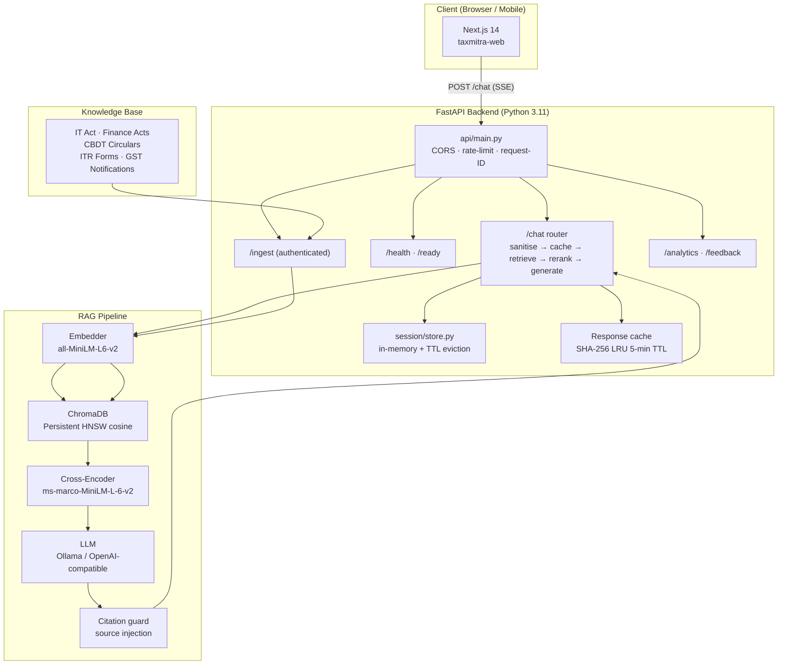

# TaxBot — Indian Income Tax & GST Assistant

A production-ready Retrieval-Augmented Generation (RAG) system that answers questions about Indian Income Tax and GST. Every answer is grounded in official documents (IT Act, Finance Acts, CBDT/CBIC circulars) with cited sources — no hallucination from model weights alone.

---

## Architecture



---

## Features

- **Grounded answers** — cites specific document, section, page, and assessment year.
- **Two-stage retrieval** — bi-encoder ANN + cross-encoder reranker.
- **"Not found" path** — refuses to answer when no context is available; never hallucinates.
- **Streaming** — token-by-token SSE with animated UI.
- **Tax calculator** — old vs. new regime comparison, animated bar chart.
- **Multi-language** — English and Hindi UI.
- **Voice input** — Web Speech API with animated waveform.
- **Command palette** — Ctrl/Cmd+K for quick actions.
- **Persistent chat history** — localStorage, with rename/delete/search.
- **Response caching** — identical questions served from a 5-min LRU cache.
- **Rate limiting** — 30 req/min/IP on `/chat`.
- **Prompt-injection guard** — rejects known attack patterns.

---

## Prerequisites

| Tool | Version | Purpose |
|------|---------|---------|
| Python | 3.11+ | Backend |
| Node.js | 20+ | Frontend |
| Ollama | latest | Local LLM (or use OpenAI API) |
| Docker | 24+ | Optional, for containerised run |
| Git | any | Clone the repo |

---

## Local Setup (without Docker)

### 1. Clone and configure

```bash
git clone https://github.com/YOUR_USERNAME/taxbot.git
cd taxbot
cp .env.example .env
```

Open `.env` and set at minimum:
```
INGEST_API_KEY=any-strong-random-string
# For Ollama (default):
LLM_PROVIDER=ollama
OLLAMA_BASE_URL=http://localhost:11434
OLLAMA_MODEL=llama3
# For OpenAI:
# LLM_PROVIDER=openai
# LLM_API_KEY=sk-...
# LLM_MODEL=gpt-4o-mini
```

### 2. Backend

```bash
python3 -m venv .venv
source .venv/bin/activate        # Windows: .venv\Scripts\activate
pip install -r requirements.txt

# Start Ollama (if using local LLM)
ollama serve &
ollama pull llama3

# Start the backend
uvicorn api.main:app --reload --host 0.0.0.0 --port 8000
```

The API is now available at `http://localhost:8000`. Visit `/docs` for the interactive Swagger UI.

### 3. Ingest starter documents

Download a few official PDFs (IT Act, CBDT circulars, GST notifications) and place them in `docs/raw/`.

```bash
python3 scripts/ingest_bulk.py --dir docs/raw/ --verbose
```

### 4. Frontend

```bash
cd taxmitra-web
cp .env.local .env.local.example  # already exists
# .env.local contains: NEXT_PUBLIC_API_URL=http://localhost:8000
npm ci
npm run dev
```

Open `http://localhost:3000`. The design system preview is at `http://localhost:3000/design`.

---

## Docker Quick-Start

```bash
cp .env.example .env
# Edit .env — set INGEST_API_KEY, LLM settings

docker compose up --build        # first run (builds images)
docker compose up                # subsequent runs

# Ingest documents
curl -X POST http://localhost:8000/ingest \
  -H "Authorization: Bearer YOUR_INGEST_API_KEY" \
  -F "file=@docs/raw/IT_Act_2024.pdf"
```

Frontend: `http://localhost:3000`
Backend API: `http://localhost:8000`
Swagger UI: `http://localhost:8000/docs`

ChromaDB data persists in the `chromadb_data` Docker volume across restarts.

---

## Deployment

### Vercel + Render (recommended)

**Backend (Render):**
1. Push this repo to GitHub.
2. At [render.com](https://render.com) → New → Blueprint → select your repo.
3. Render reads `render.yaml` automatically.
4. Set secrets in the Render dashboard: `INGEST_API_KEY`, `LLM_API_KEY`, `SENTRY_DSN`.

**Frontend (Vercel):**
1. At [vercel.com](https://vercel.com) → New Project → import the same repo.
2. Set root directory: `taxmitra-web`.
3. Add environment variable: `NEXT_PUBLIC_API_URL=https://your-render-service.onrender.com`.
4. Deploy.

See [docs/custom-domain.md](docs/custom-domain.md) for adding a custom domain.

### AWS alternative

See [docs/aws-deployment.md](docs/aws-deployment.md) for ECR + App Runner or ECS Fargate instructions.

---

## Running Tests

```bash
# Unit and integration tests
pytest tests/ -v

# With coverage
pytest tests/ --cov=api --cov=generation --cov=retrieval --cov=ingestion --cov=session

# Evaluation (requires a running server)
python3 scripts/evaluate.py --server http://localhost:8000
```

The evaluation script grades answers against `scripts/eval_dataset.json`. It fails with exit code 1 if the pass rate drops below 80 % or p95 latency exceeds 15 s.

---

## CI/CD

GitHub Actions workflows in `.github/workflows/`:

| Workflow | Trigger | Jobs |
|----------|---------|------|
| `backend-ci.yml` | push/PR touching `.py` | lint → typecheck → test → eval (on main) |
| `frontend-ci.yml` | push/PR touching `taxmitra-web/` | lint → typecheck → build |
| `docker-push.yml` | merge to main | build & push both images to GHCR |
| `deploy.yml` | after docker-push | deploy to Render + Vercel |
| `kb-update.yml` | Feb 1 + Apr 2 (cron) | ingest new tax year documents |

Thresholds are in `.github/eval-config.yml` — edit to tighten the accuracy gate.

---

## Knowledge Base Update (annual)

After each Union Budget or financial-year change:

1. Download updated documents:
   - IT Act consolidated: [incometax.gov.in](https://incometax.gov.in)
   - Finance Act: [egazette.gov.in](https://egazette.gov.in)
   - CBDT circulars: [incometax.gov.in/cbdt-circulars](https://incometax.gov.in/cbdt-circulars)
   - GST notifications: [cbic.gov.in/resources](https://cbic.gov.in/resources)

2. Place PDFs in `docs/raw/AY2025-26/`.

3. Run the update script:
   ```bash
   python3 scripts/scheduled_kb_update.py --dir docs/raw/AY2025-26/ --server https://api.yourdomain.com
   ```

The GitHub Actions `kb-update.yml` workflow triggers automatically on Feb 1 and Apr 2.

---

## Configuration Reference

All settings are read from environment variables (or `.env`). See `.env.example` for the full list with descriptions. Key variables:

| Variable | Default | Description |
|----------|---------|-------------|
| `INGEST_API_KEY` | *required* | Bearer token for `POST /ingest` |
| `LLM_PROVIDER` | `ollama` | `ollama` or `openai` |
| `OLLAMA_MODEL` | `llama3` | Ollama model name |
| `LLM_MODEL` | `gpt-4o-mini` | OpenAI-compatible model |
| `ALLOWED_ORIGINS` | `*` | CORS origins (restrict in prod) |
| `SENTRY_DSN` | *(unset)* | Sentry DSN for error tracking |
| `CHROMA_DB_PATH` | `./data/chromadb` | ChromaDB persistence directory |
| `SIMILARITY_THRESHOLD` | `0.40` | Min cosine similarity for retrieval |
| `RATE_LIMIT_PER_MINUTE` | `30` | Chat rate limit per IP |

---

## Monitoring

See [docs/monitoring.md](docs/monitoring.md) for the full monitoring setup, covering uptime checks (BetterUptime/UptimeRobot), error tracking (Sentry), and the built-in `/analytics` endpoint.

Quick health check:
```bash
curl https://api.yourdomain.com/health | python3 -m json.tool
```

---

## Troubleshooting

### `ModuleNotFoundError: No module named 'nltk'` (or any package)
```bash
pip install -r requirements.txt
```

### NLTK punkt data not found
```bash
python3 -c "import nltk; nltk.download('punkt'); nltk.download('punkt_tab')"
```
The server also downloads this automatically at startup.

### `Cannot connect to Ollama at http://localhost:11434`
```bash
ollama serve          # start the Ollama daemon
ollama pull llama3    # pull the model if not already downloaded
```

### ChromaDB path error on startup
Ensure `CHROMA_DB_PATH` exists and is writable:
```bash
mkdir -p ./data/chromadb
```

### CORS error in browser
Set `ALLOWED_ORIGINS` to your frontend URL:
```
ALLOWED_ORIGINS=https://taxmitra.yourdomain.com
```
Then restart the backend.

### `401 Unauthorized` on `/ingest`
The `Authorization: Bearer <INGEST_API_KEY>` header must match the `INGEST_API_KEY` env var exactly. Check for trailing spaces.

### Evaluation pass rate below threshold
1. Confirm documents are ingested: `GET /health` → `total_chunks > 0`.
2. Lower `SIMILARITY_THRESHOLD` to `0.3` and re-run.
3. Add more source documents covering the failing question categories.

### `413 Request Entity Too Large` on `/ingest`
The file exceeds the 50 MB limit. Split large PDFs or extract relevant sections.

---

## Project Structure

```
taxbot/
├── api/                    FastAPI application and routers
│   ├── main.py             App factory, middleware, lifespan
│   ├── routers/            chat, health, ingest, analytics
│   ├── schemas.py          Pydantic request/response models
│   ├── auth.py             Bearer-token auth for /ingest
│   ├── cache.py            Response LRU cache
│   ├── analytics.py        In-process counters
│   └── sanitize.py         Input sanitisation + injection guard
├── generation/             Prompt building, LLM clients, citation guard
├── retrieval/              Embedder, ChromaDB store, retriever, reranker
├── ingestion/              PDF/HTML/text loaders, chunker, pipeline
├── session/                In-memory session store with TTL eviction
├── scripts/                ingest_bulk, evaluate, scheduled_kb_update
├── tests/                  pytest suite (unit + integration + eval logic)
├── taxmitra-web/           Next.js 14 frontend
│   ├── src/app/            Pages (/, /chat, /design)
│   ├── src/components/     Chat, calculator, sidebar, command palette
│   └── src/lib/            API client, tax calculation engine, motion
├── docs/                   aws-deployment.md, custom-domain.md, monitoring.md
├── Dockerfile              Multi-stage backend image
├── docker-compose.yml      Backend + frontend + persistent volume
├── render.yaml             Render.com blueprint
└── .github/workflows/      CI/CD pipelines
```

---

## Disclaimer

TaxBot provides informational answers only. It is not a substitute for professional tax advice. Always verify with the latest notifications at [incometax.gov.in](https://incometax.gov.in) or [gst.gov.in](https://gst.gov.in), or consult a Chartered Accountant.

---

## Licence

MIT
